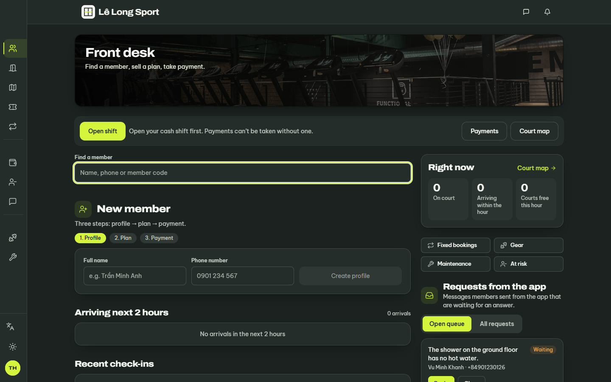
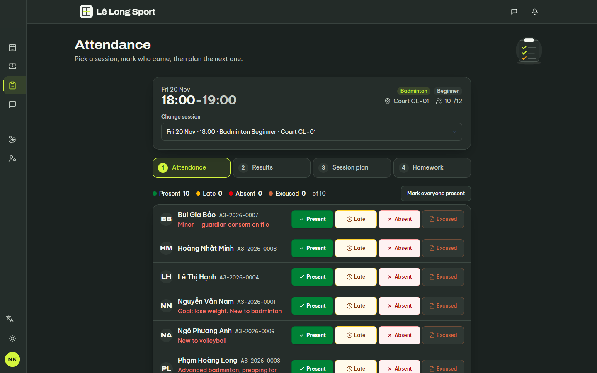
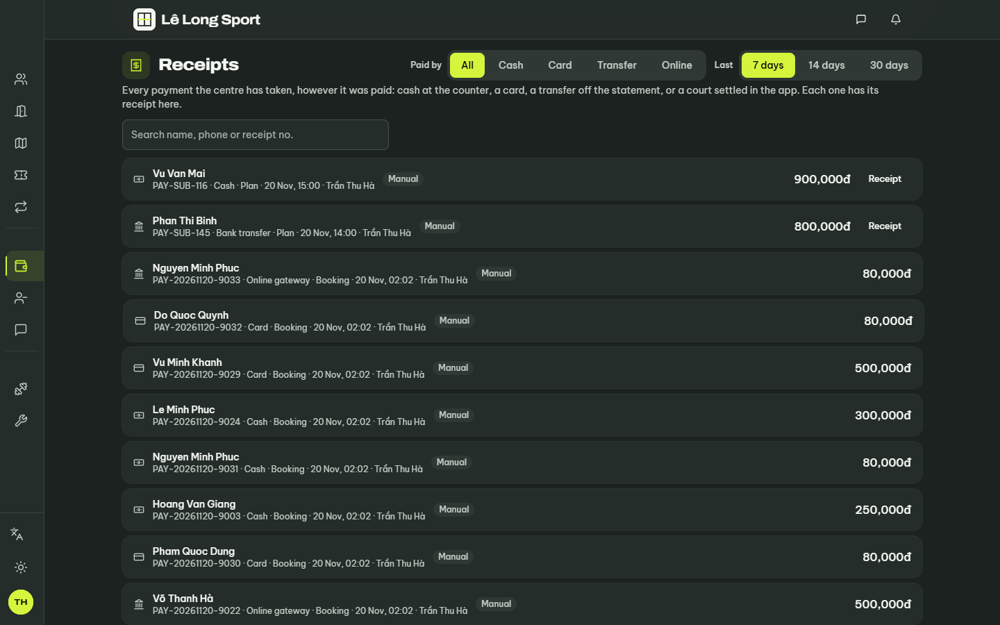
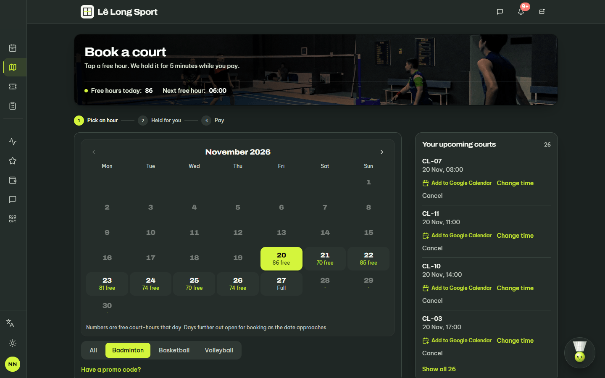
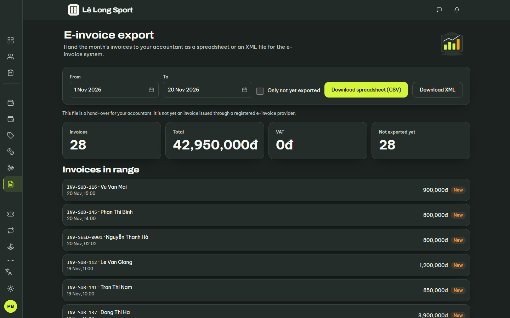
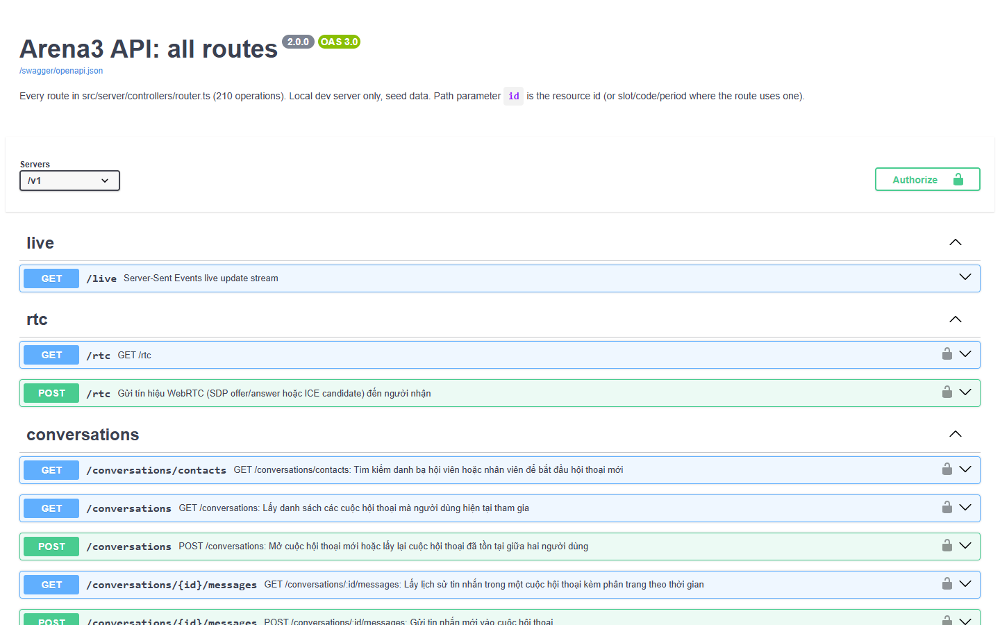
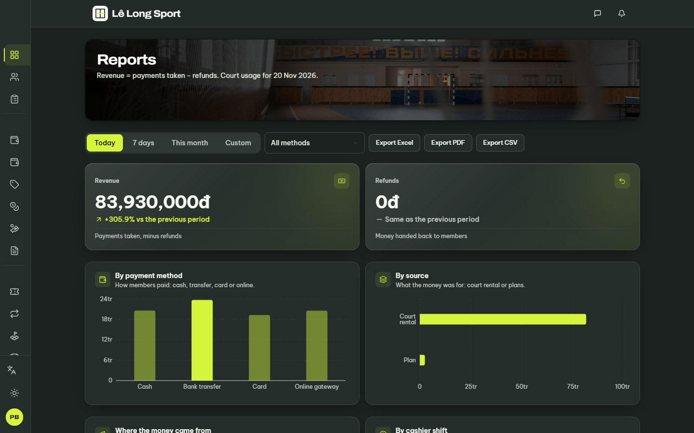
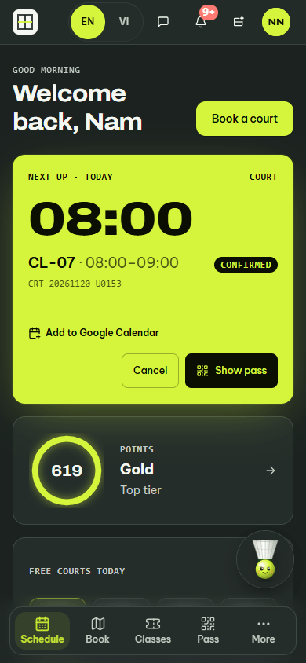
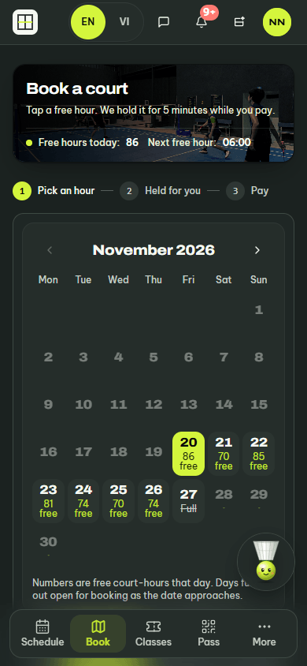
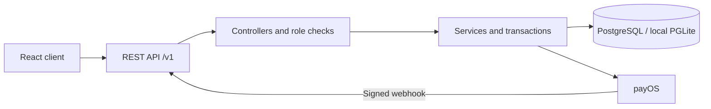

# Arena3

Sports centre management web app: courts, classes, packages, payments and reports for four user roles.

[Live demo](https://www.lelongsport.online) · [API docs](https://www.lelongsport.online/swagger/index.html) · [SRS](docs/Arena3-SRS-v2.2.pdf)

Arena3 is an academic team project at FPT University. The interface uses the centre name **Lê Long Sport** and supports English and Vietnamese.


## Features

| Role         | Capabilities                                                                                                                                              |
| ------------ | --------------------------------------------------------------------------------------------------------------------------------------------------------- |
| Manager      | Manage courts, sports, prices, plans, classes and staff; review revenue, court usage and attendance; approve refunds; export invoices and audit activity. |
| Receptionist | Open and close cashier shifts; register members and sell plans; record payments and refunds; handle walk-ins, fixed bookings and gate check-in.           |
| Coach        | View teaching schedules and student lists; mark attendance; record results, session plans and homework; review earnings.                                  |
| Member       | Hold and book courts; enrol in classes and order plans; view schedules, progress and points; present a rotating QR pass and receive notifications.        |

## Screenshots

All captures use the running local app with synthetic seed data. Desktop captures are 1440 × 900; mobile captures are 390 × 844.

| Front desk and finance                                                                         | Teaching and member experience                                                                                           |
| ---------------------------------------------------------------------------------------------- | ------------------------------------------------------------------------------------------------------------------------ |
| **Cashier desk and shift status**<br>    | **Coach attendance register**<br>                              |
| **Payment receipts**<br>          | **Court booking calendar**<br>                                          |
| **VAT invoices and CSV/XML export**<br> | **Interactive API documentation**<br>                                      |
| **Revenue and court usage reports**<br>             | **Member schedule on mobile**<br> |

<details>
<summary>Mobile court booking</summary>



</details>

## Tech stack

| Area                   | Technologies                                                                                                   |
| ---------------------- | -------------------------------------------------------------------------------------------------------------- |
| Frontend               | TypeScript, React 19, TanStack Start/Router/Query, Tailwind CSS 4, Radix UI, Zustand, GSAP, Motion             |
| Backend / API          | TanStack Start server routes, application controllers and services, Zod, REST API under `/v1`, Swagger/OpenAPI |
| Database               | PostgreSQL 16, `pg`, PGLite for local development, SQL migrations                                              |
| Payments and documents | payOS Node SDK, QRCode, PDF-lib, invoice CSV/XML export                                                        |
| Testing                | Node.js test runner, TypeScript tests via `tsx`, Playwright                                                    |
| Tooling                | Vite 8, Nitro, ESLint, Prettier, Sharp for screenshot compression                                              |

## Architecture



The server owns validation, authorisation and payment settlement. SQL migrations define the schema for both database backends.

## Technical highlights

- payOS webhooks verify signatures and payment amounts; row locks and settlement state prevent duplicate posting.
- Cashier shifts link receipts and refunds to the desk, with counted-cash reconciliation and discrepancy notifications.
- VAT invoices, adjustment invoices and refund approval/payout flows keep financial records traceable.
- Server-side role checks restrict manager, receptionist, coach and member operations.
- PGLite runs the application locally with migrations and seed data, without a separate database server.
- Tests cover payment settlement, refunds, booking conflicts, permissions, rate limits and client behaviour.

CSV/XML invoice export is an accountant handoff; it does not issue invoices through a registered e-invoice provider. Online payOS payment requires configuration and is not simulated in the screenshots.

## Getting started

Use **Node.js 22.12+** and npm; this checkout was verified with Node.js 24.12. Vite also supports Node.js 20.19+, but the test commands use Node's TypeScript stripping support.

```bash
git clone https://github.com/thanhsu263/sport-center-management-system.git
cd sport-center-management-system
npm install
cp .env.example .env
npm run dev
```

Open `http://localhost:8080`. No external service credentials are needed for the core local demo. PGLite applies migrations and keeps its data in `.pglite/`; `PGLITE_DATA_DIR=memory` makes the database temporary.

Configuration is documented in [.env.example](.env.example). Set optional integrations only when you need them; keep server credentials out of `VITE_` variables.

| Variables                                                       | Purpose                                                                                | Required?                           |
| --------------------------------------------------------------- | -------------------------------------------------------------------------------------- | ----------------------------------- |
| `DATABASE_URL`                                                  | PostgreSQL connection for production; builds apply pending migrations to this database | Production PostgreSQL               |
| `PGLITE_DATA_DIR`                                               | Local embedded database directory, or temporary in-memory mode                         | No                                  |
| `PAYOS_CLIENT_ID`, `PAYOS_API_KEY`, `PAYOS_CHECKSUM_KEY`        | Create payment links and verify payOS webhooks                                         | Online payment only                 |
| `BANK_BIN`, `BANK_ACCOUNT_NO`, `BANK_ACCOUNT_NAME`, `BANK_NAME` | Centre bank details for manual VietQR transfers                                        | Bank transfer QR only               |
| `GEMINI_API_KEY`, `GOOGLE_API_KEY`, `GEMINI_MODELS`             | Optional Gemini assistant and model selection                                          | AI responses only                   |
| `ASSISTANT_SECRET`                                              | Keep signed assistant conversation context consistent across instances                 | Assistant in production             |
| `OTP_SECRET`, `OTP_ECHO`                                        | OTP hashing and development-only OTP response visibility                               | Configure for production            |
| `SMTP_HOST`, `SMTP_PORT`, `SMTP_USER`, `SMTP_PASS`, `MAIL_FROM` | Deliver account emails through SMTP                                                    | Email delivery only                 |
| `MAIL_TRANSPORT`                                                | Optional development email transport                                                   | No                                  |
| `GOOGLE_CLIENT_ID`                                              | Optional linked Google account sign-in                                                 | Google sign-in only                 |
| `TURNSTILE_SECRET_KEY`, `VITE_TURNSTILE_SITE_KEY`               | Optional human verification for registration/recovery                                  | No                                  |
| `VITE_PUBLIC_URL`                                               | Public address used by phone-based check-in links                                      | No                                  |
| `VITE_DEMO_LOGINS`                                              | Show or hide the local one-tap demo account buttons                                    | No; hidden by default in production |

## Demo accounts — local seed only

Start the app locally and open `/login`. Use the **Demo accounts** buttons to try Manager, Front desk, Coach or Member. The buttons use the seeded credentials without requiring a password to be copied into this README.

These instructions apply to a local seed database. No live account passwords are published here. Keep demo logins disabled on a deployment used by real members.

## Scripts

| Command                              | Purpose                                                            |
| ------------------------------------ | ------------------------------------------------------------------ |
| `npm run dev`                        | Start the local development server                                 |
| `npm run build`                      | Build for production, then run database migrations when configured |
| `npm run typecheck`                  | Check TypeScript without emitting files                            |
| `npm run lint`                       | Run ESLint                                                         |
| `npm test`                           | Run the configured Node.js and TypeScript test groups              |
| `npm run check:api`                  | Check API behaviour against a running local app                    |
| `npm run demo:swagger`               | Exercise demo flows through local Swagger UI                       |
| `npm run check:auth`                 | Check server authorisation invariants                              |
| `npm run screenshots -- --seed-demo` | Capture and compress the local seed UI                             |

## Project structure

```text
src/
  client/             UI components, state, API client and translations
  routes/             TanStack pages and server route entry points
  server/
    controllers/      API dispatch, role checks and request handlers
    services/         Application rules and reusable operations
    integrations/     payOS, Gemini, email and PDF generation
    data/             Database adapters and data helpers
  shared/             Contracts, labels and date/time helpers
migrations/           SQL schema and seed migrations
scripts/              Checks, tests, demo tools and screenshots
public/swagger/       Swagger UI and OpenAPI specification
docs/                 SRS, diagrams and product screenshots
```

## Testing

```bash
npm run typecheck
npm run lint
npm test
```

Payment and controller tests use PGLite and test doubles for external services. They include duplicate webhook settlement, refunds, permissions, cashier rules and booking conflicts. Swagger demo scripts require the local server and modify demo data.

The cleanup baseline has existing failures: two `no-control-regex` lint errors, one F-09 booking-conflict test, and template script checks that depend on missing platform files or filesystem behaviour. This README does not claim a passing test suite. On Windows, the current quoted script-test glob may select no files; run those tests explicitly in PowerShell:

```powershell
$scriptTests = @(Get-ChildItem scripts -Recurse -Filter *.test.mjs | ForEach-Object FullName)
node --test @scriptTests
```

To refresh screenshots, start a local app containing only seed/demo data, then run:

```bash
npm run screenshots -- --seed-demo
```

Playwright uses bundled Chromium or an installed Chrome/Edge. If needed, install its browser with `npx playwright install chromium`. Screenshots keep the default app theme. The landing capture waits for its normal intro, visible content and counters to settle; other screens reduce motion. PNGs are compressed to at most 300 KB each and 3 MB total. Inspect every image before publishing. To refresh just the landing page, run `npm run screenshots -- --seed-demo --only 01-landing.png`.

## Team

- Nguyễn Trọng Toàn - [toan22102006a-collab](https://github.com/toan22102006a-collab)
- Hiếu — [facingshootingstar](https://github.com/facingshootingstar)
- Dang Trang Thanh Su — [thanhsu263](https://github.com/thanhsu263)
- Phúc — [hoangphucio](https://github.com/hoangphucio)
- Tân — [TanCandy](https://github.com/TanCandy)

## License

This project is licensed under the [MIT License](LICENSE). Third-party media retain their own attribution and licensing; see [media credits](public/media/library/CREDITS.md).
